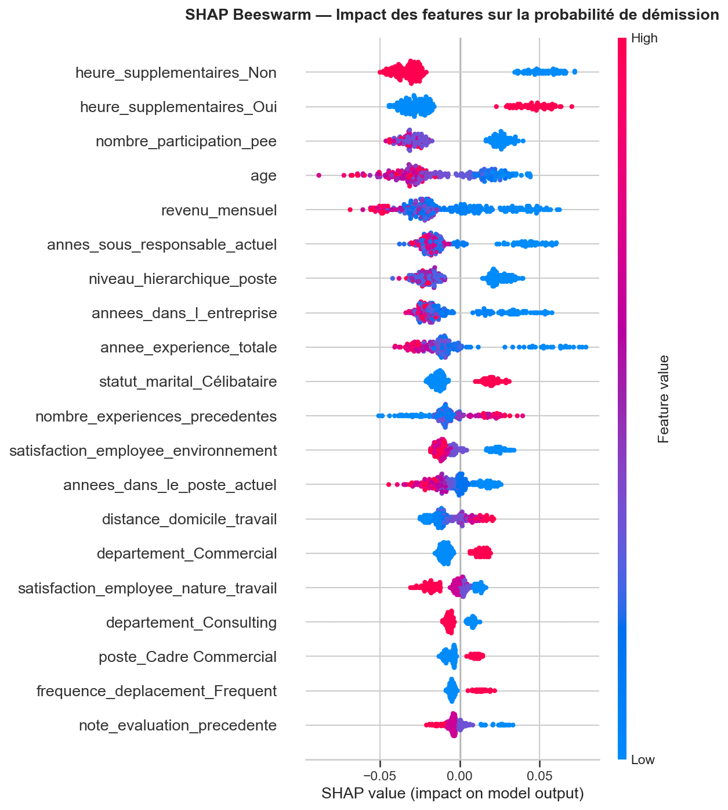
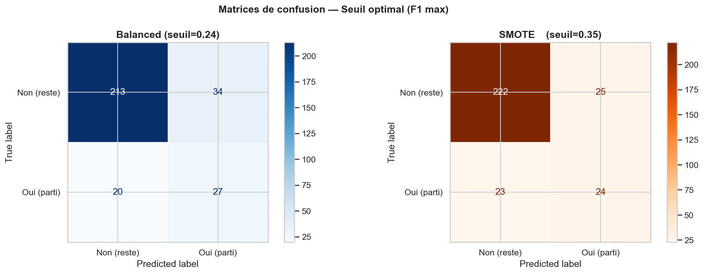

# Prédiction et explication de l'attrition des salariés — TechNova Partners

Identifier **pourquoi** des consultants quittent une ESN et **détecter les salariés à risque**, à partir de trois sources RH croisées (SIRH, évaluations annuelles, sondage bien-être).

> Projet réalisé dans le cadre du parcours *Data Scientist Machine Learning* d'OpenClassrooms. TechNova Partners est une entreprise fictive ; les données sont fournies pour la formation.



## Problématique

L'entreprise constate un turnover élevé et veut comprendre ses causes pour agir. Deux contraintes structurent le projet :

- **classes déséquilibrées** : seuls ~16 % des salariés sont partis, donc un modèle qui prédit toujours « reste » atteint 84 % d'accuracy sans rien détecter ;
- **coût d'erreur asymétrique** : rater un futur démissionnaire (faux négatif) coûte plus cher qu'une alerte en trop. Le **rappel sur la classe « départ »** est donc la métrique prioritaire.

## Démarche

| Étape | Contenu |
|---|---|
| 1. Données | Chargement des 3 extraits, nettoyage, harmonisation des types, construction d'une clé commune et jointure (1 470 salariés) |
| 2. Analyse exploratoire | Comparaison partis / restants : boxplots, taux de départ par modalité, corrélations de Pearson et de Spearman |
| 3. Feature engineering | Suppression des variables sans pouvoir discriminant, encodage adapté au type (OneHot, Ordinal), standardisation dans un `ColumnTransformer` |
| 4. Baseline | Dummy → Régression logistique → Random Forest, split train/test stratifié |
| 5. Déséquilibre | `class_weight='balanced'` vs **SMOTE** dans un pipeline `imblearn` (sans fuite de données), validation croisée stratifiée 5 folds |
| 6. Optimisation | `RandomizedSearchCV` orienté rappel, choix du **seuil de décision** sur la courbe précision-rappel |
| 7. Interprétabilité | Importance native, importance par permutation, **SHAP** global (beeswarm) et local (waterfall par salarié) |

## Résultats

Sur le jeu de test (294 salariés, dont 47 départs) :

| Modèle | Rappel « départ » | Précision « départ » | F1 « départ » |
|---|---|---|---|
| Dummy (référence) | 0,00 | 0,00 | 0,00 |
| Random Forest fine-tuné | **0,55** | 0,45 | 0,50 |
| Random Forest, seuil ajusté (0,24) | **0,57** | 0,44 | 0,50 |

Le modèle final repère plus d'un départ sur deux, contre aucun pour la référence, avec un écart train/test maîtrisé après fine-tuning (le Random Forest par défaut sur-apprenait : 100 % en train).



## Principaux facteurs de départ

D'après l'analyse SHAP et les taux de départ observés :

- **Heures supplémentaires** : premier facteur, avec un taux de départ d'environ 30 % chez les salariés concernés contre 10 % chez les autres ;
- **faible participation au plan d'épargne entreprise (PEE)** ;
- **profil junior** : jeune âge, revenu mensuel bas, peu d'ancienneté et de niveau hiérarchique ;
- **célibat** et **déplacements fréquents** ;
- **faible satisfaction vis-à-vis de l'environnement de travail**.

Ces résultats orientent des actions RH concrètes : suivi de la charge de travail, politique de rémunération des juniors, accompagnement des salariés très mobiles.

## Structure du dépôt

```
hr-attrition-prediction/
├── data/                        # 3 extraits RH (SIRH, évaluations, sondage)
├── notebooks/
│   └── hr_attrition_analysis.ipynb
├── reports/
│   ├── figures/                 # graphiques générés par le notebook
│   └── presentation_attrition.pdf
├── requirements.txt
└── README.md
```

## Lancer le projet

```bash
git clone https://github.com/fatimaadda2878/hr-attrition-prediction.git
cd hr-attrition-prediction
python -m venv .venv
source .venv/bin/activate        # Windows : .venv\Scripts\activate
pip install -r requirements.txt
jupyter notebook notebooks/hr_attrition_analysis.ipynb
```

## Stack

Python · pandas · NumPy · scikit-learn · imbalanced-learn (SMOTE) · SHAP · Matplotlib · Seaborn · Jupyter

## Auteure

**Fatima ADDA-REZIG** — Data Scientist Machine Learning, ex-ingénieure biochimiste
[Portfolio](https://fatimaadda2878.github.io) · [LinkedIn](https://www.linkedin.com/in/fatima-adda-rezig-72b60b164/)
